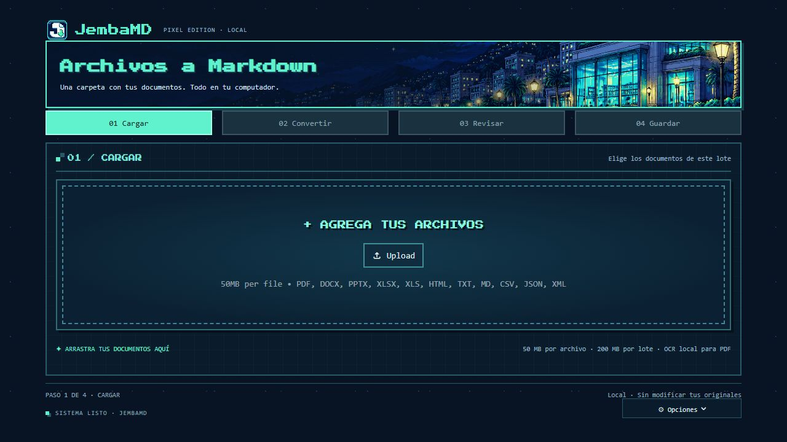

# JembaMD

Convertidor local de documentos a Markdown en Windows, con interfaz en espanol,
ventana de escritorio, tema pixel art y OCR local para PDF escaneados.



## Estructura

```text
JembaMD/
├── src/          Interfaz, conversion, OCR y puente de escritorio
├── assets/       Logos, iconos, fondo, CSS, fuente y licencia
├── scripts/      Preparacion e inicio
├── tests/        Conversiones con documentos ficticios
├── docs/         Guia de uso
├── empaquetado/  Construccion del portable de Windows
├── .streamlit/   Configuracion publica de la interfaz
├── iniciar.bat
├── JembaMD.vbs
└── requirements.txt
```

## Instalar y abrir

Instala Python 3.12 x64 y ejecuta `iniciar.bat`. Prepara el entorno `.venv`, instala las dependencias
y abre la ventana. Para los siguientes inicios puedes usar `JembaMD.vbs` o tu acceso directo existente.
La ventana requiere Microsoft Edge WebView2; el OCR usa los idiomas OCR instalados en Windows.
Solo la instalacion inicial de dependencias necesita internet.

Alternativa manual desde PowerShell, en la carpeta principal:

```powershell
py -3.12 -m venv .venv
.\.venv\Scripts\python.exe -m pip install -r requirements.txt
.\.venv\Scripts\python.exe src/escritorio.py
```

Para iniciar en el navegador:

```powershell
powershell -NoProfile -ExecutionPolicy Bypass -File .\scripts\iniciar.ps1 -Navegador
```

## Uso y datos

Carga documentos, conviertelos, revisa el Markdown y guarda una carpeta nueva con los resultados.
Formatos: PDF, DOCX, PPTX, XLSX, XLS, HTML, HTM, TXT, MD, CSV, JSON y XML.
Limites: 50 MB por archivo y 200 MB por lote. Los originales no se modifican.
Consulta [Guia de uso](docs/GUIA-USO.md) para los detalles y limites de conversion.

`salidas`, `.logs`, `.webview`, `.venv`, documentos privados y `para_compartir` se excluyen de Git.
Los logos, iconos, fondo, CSS y fuente se incluyen. Las atribuciones y la licencia estan en `assets`.
Las direcciones `127.0.0.1` comunican componentes dentro del mismo computador.
El token del puente se genera por instancia y no es una clave personal escrita en el codigo.

## Pruebas y portable

```powershell
.\.venv\Scripts\python.exe tests/verificar.py
.\.venv\Scripts\python.exe src/escritorio.py --verificar
```

Las conversiones de prueba usan documentos ficticios en memoria y exportan a una carpeta temporal.
La comprobacion de escritorio abre la ventana de forma oculta y cierra su servidor al terminar.

`empaquetado/crear_portable.py` construye un portable con Python 3.12 y las dependencias del entorno.
El launcher de .NET inicia `src/escritorio.py` dentro del paquete. El ZIP generado en `para_compartir`
se excluye de Git: debe construirse por separado antes de compartirlo.
